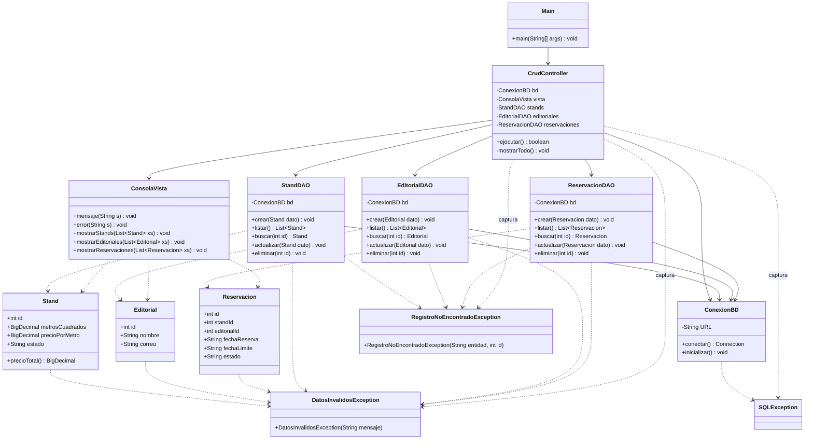

# Diagrama de clases PD5

`ConexionBD` se encarga únicamente de la conexión y la inicialización del esquema. Cada DAO contiene las operaciones de una entidad. Los modelos no conocen JDBC y la vista no contiene SQL.
