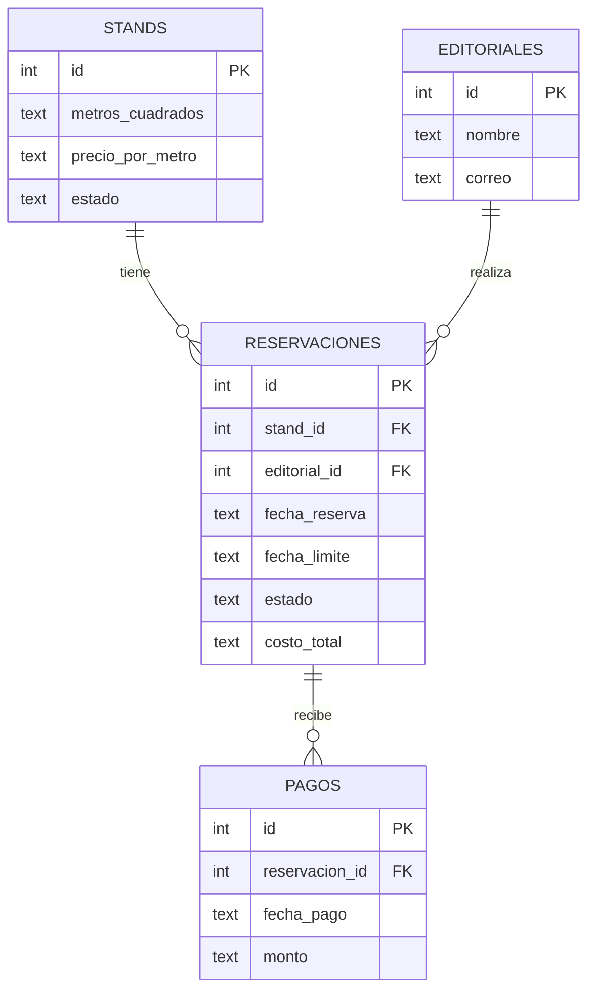

# Diagrama entidad-relación PD6

Una reservación pertenece a una editorial y a un stand. Una reservación puede tener cero o varios pagos; cada pago corresponde a una sola reservación. No se repite el ID de editorial en pagos, ya que se obtiene mediante la reservación. Los importes se almacenan como texto decimal para conservar la precisión de BigDecimal.
