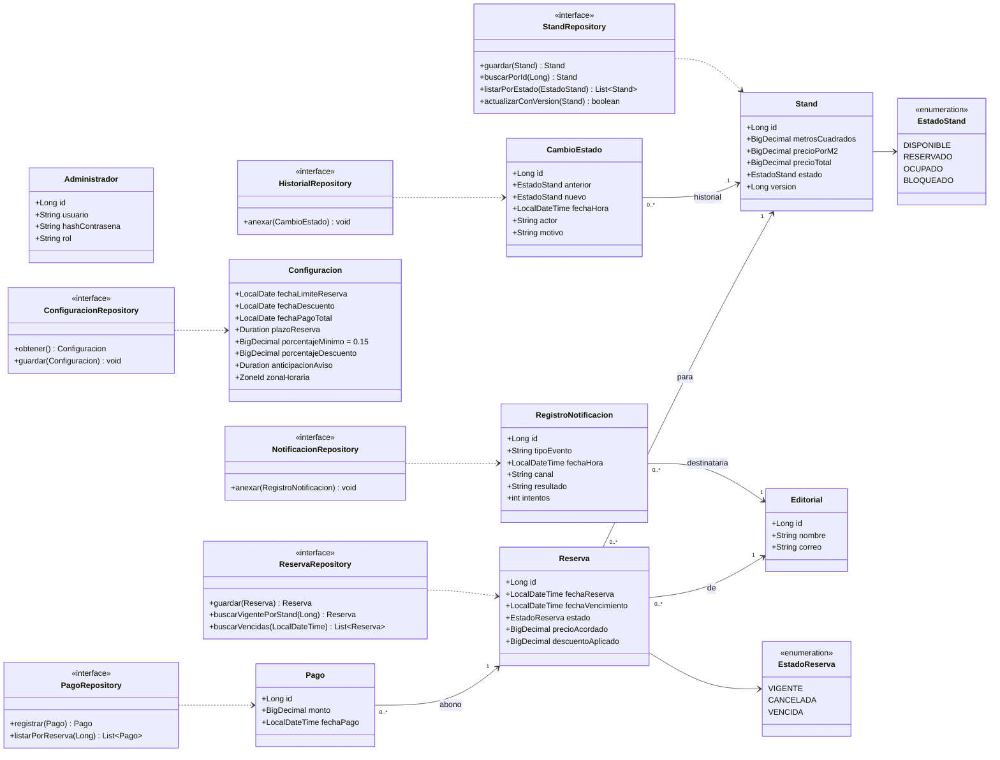

# FILEY — Diagrama de clases: paquete `datos`

**Notas:** Los identificadores de stand son irreutilizables; `version` permite control de concurrencia optimista. Los pagos y el historial solo admiten inserciones, no edición o borrado. `precioAcordado` congela el importe base de una reserva para evitar alteraciones retroactivas.
