# FILEY — Diagrama de clases: paquete `negocio`

```mermaid
classDiagram
 direction TB
 class StandService {
   +crearStand(m2, precioM2) Stand
   +modificarStand(id, m2, precioM2) Stand
   +listar(estado) List~Stand~
   +bloquear(id) void
   +liberarBloqueado(id) void
 }
 class ReservaService {
   +reservar(standId, editorialId) Reserva
   +cancelar(reservaId) void
   +transferir(reservaId, editorialId) void
   +asignarBloqueado(standId, editorialId) Reserva
 }
 class PagoService {
   +registrarPago(reservaId, monto) Pago
   +calcularSaldo(reservaId) BigDecimal
   +porcentajeCubierto(reservaId) BigDecimal
 }
 class PrecioService {
   +calcularTotal(m2, precioM2) BigDecimal
   +calcularDescuento(total, fecha, config) BigDecimal
 }
 class GestorEstados {
   +cambiar(stand, nuevo, contexto) void
   +esTransicionValida(actual, nuevo, contexto) boolean
 }
 class ReglaTransicion {
   <<interface>>
   +permite(actual, nuevo, contexto) boolean
 }
 class PoliticaTransiciones {
   +permite(actual, nuevo, contexto) boolean
 }
 class VencimientoService {
   +procesarReservasVencidas() void
   +procesarAvisos() void
 }
 class ResumenService {
   +resumenStands() Resumen
   +resumenCobros() Resumen
 }
 class ConfiguracionService {
   +actualizarParametros(config) void
   +obtenerParametros() Configuracion
 }
 class AutorizacionService {
   +exigirAdministrador(usuario) void
 }
 class PublicadorEventos {
   <<interface>>
   +publicar(evento) void
 }
 class EventoDominio {
   <<interface>>
   +tipo() String
   +fechaHora() LocalDateTime
 }
 class StandRepository {
   <<interface>>
 }
 class ReservaRepository {
   <<interface>>
 }
 class PagoRepository {
   <<interface>>
 }
 class ConfiguracionRepository {
   <<interface>>
 }
 class HistorialRepository {
   <<interface>>
 }
 ReglaTransicion <|.. PoliticaTransiciones
 StandService --> GestorEstados
 ReservaService --> GestorEstados
 PagoService --> GestorEstados
 GestorEstados --> ReglaTransicion
 GestorEstados --> HistorialRepository
 StandService --> StandRepository
 ReservaService --> StandRepository
 ReservaService --> ReservaRepository
 PagoService --> PagoRepository
 PagoService --> ReservaRepository
 PagoService --> PrecioService
 VencimientoService --> ReservaRepository
 VencimientoService --> GestorEstados
 ConfiguracionService --> ConfiguracionRepository
 ReservaService --> PublicadorEventos
 PagoService --> PublicadorEventos
 VencimientoService --> PublicadorEventos
 PublicadorEventos ..> EventoDominio
 StandService --> AutorizacionService
 ReservaService --> AutorizacionService
 PagoService --> AutorizacionService
```

**Notas:** Los servicios dependen de interfaces, no de canales de notificación. El `GestorEstados` centraliza reglas y crea trazas. Las operaciones que modifican reserva, stand y pago deben ejecutarse en transacciones; el alta de reserva usa bloqueo transaccional o control de versión para impedir dobles reservas. La transferencia y la asignación directa son opcionales.
