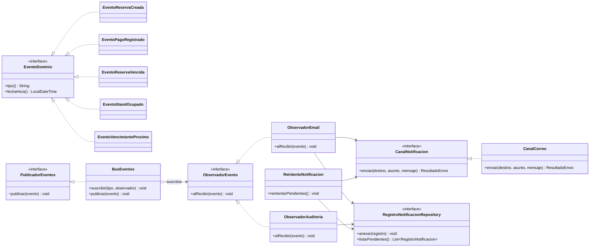

# FILEY — Diagrama de clases: paquete `notificaciones`

**Notas:** Observer desacopla el negocio de los canales. Se puede añadir `CanalWhatsApp` implementando `CanalNotificacion` sin cambiar servicios. Para que los errores de envío no reviertan reservas/pagos, persistir eventos pendientes dentro de la transacción de negocio (outbox) y distribuirlos después; registrar el resultado y reintentar cuando falle.
