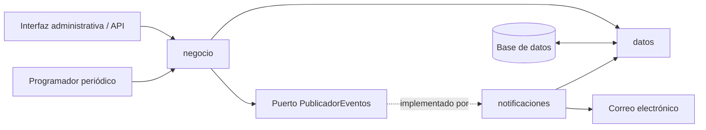

# FILEY — Dependencias entre paquetes

`datos` no depende de `negocio` ni `notificaciones`. `negocio` publica eventos mediante un **puerto/interfaz**, sin depender de implementaciones de correo. `notificaciones` implementa ese puerto. La interfaz administrativa requiere autenticación con rol administrador.
