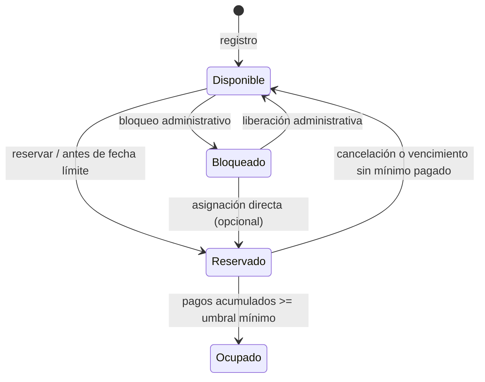

# FILEY — Diagrama de estados de un stand

**Reglas:** El mínimo es configurable (15 % por defecto). `Ocupado` no tiene transición de salida definida en los requisitos. El motor central rechaza cualquier transición no dibujada. Una reserva no puede iniciarse después de la fecha límite configurada.
