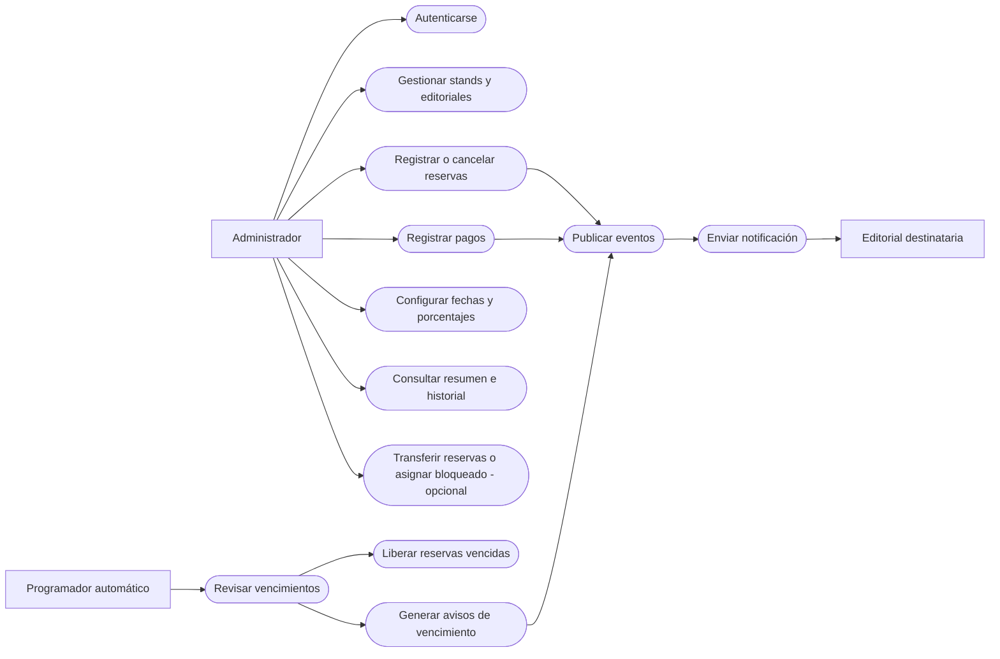

# FILEY — Diagrama de casos de uso

**Nota:** El diagrama representa actores y funcionalidades principales en un formato compatible con GitHub; las editoriales son destinatarias de avisos, no usuarios administrativos según estos requisitos.
