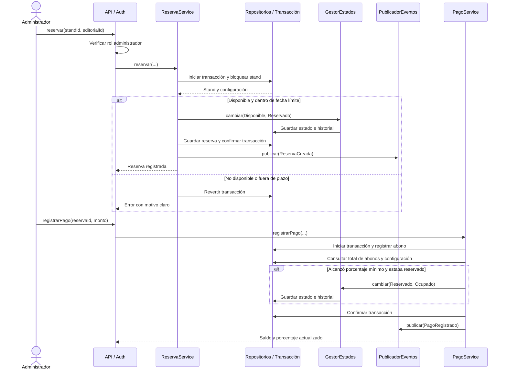

# FILEY — Secuencia de reserva y pago

**Notas:** El publicador debe entregar eventos después del commit, con soporte de outbox para no perderlos. Las validaciones de descuentos y saldos usan `BigDecimal` con redondeo definido. Los abonos solo se registran en reservas válidas y el pago se procesa de manera atómica.
