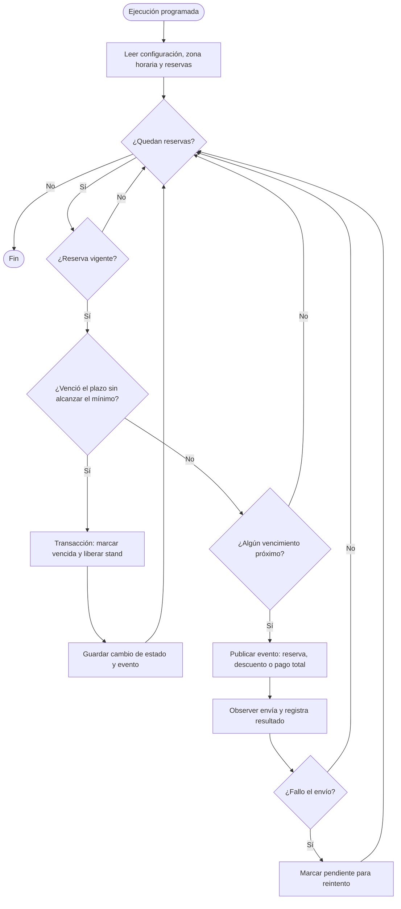

# FILEY — Flujo de vencimientos y avisos

**Notas:** Los plazos se calculan con la zona horaria configurada; una entrega fallida no revierte cambios de negocio. Se evita enviar recordatorios duplicados del mismo tipo para el mismo vencimiento.
